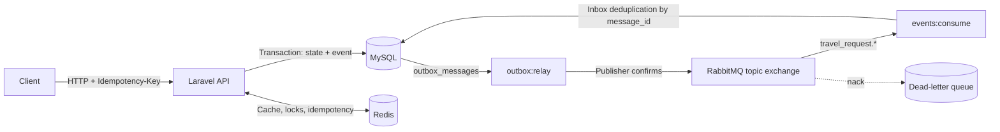

# TripFlow

[Português](README.md) · **English**

**A corporate travel API with budget-aware approvals and domain events.** TripFlow covers the lifecycle from travel request to booking, with per-company access rules, concurrency control, and asynchronous integration. Bookings use a simulated supplier.

[Stack](#technology-stack) · [Technical decisions](#technical-decisions) · [Architecture](#architecture) · [Run the demo](#run-the-demo) · [ADRs](#architecture-decision-records)

## Technology stack

| Technology | Role in TripFlow |
| --- | --- |
| **PHP 8.3, Laravel 12, and Sanctum** | REST API, validation, role-based authorization, and access tokens. |
| **MySQL 8.4** | Travel state, bookings, budgets, transactional locks, outbox, and inbox. |
| **Redis 7** | Budget caching, distributed locks, and storage for idempotent responses. |
| **RabbitMQ 4 and php-amqplib** | Domain event publishing, broker confirms, and dead-letter routing. |
| **Docker Compose and Codespaces** | Reproducible development stack with the API, database, cache, and broker. |
| **Pest, Larastan, Pint, and GitHub Actions** | Tests, static analysis, formatting, and CI/CD automation. |

## Technical decisions

| Problem | Decision and rationale | Details |
| --- | --- | --- |
| The database and broker can fail independently | A transactional outbox records the event in the same transaction as the state change. A separate relay publishes it and retries failures with backoff. | [ADR 0002](docs/adr/0002-transactional-outbox.md) |
| Concurrent approvals can overspend a cost center | A `SELECT … FOR UPDATE` lock serializes approvals for the same cost center. A fixed lock order reduces deadlock risk. | [ADR 0003](docs/adr/0003-concorrencia-orcamento-e-reservas.md) |
| Client retries can duplicate side effects | `Idempotency-Key` lets the API replay the saved response. A distributed lock coordinates booking without holding a database transaction open during the supplier call. | [Middleware](app/Http/Middleware/EnsureIdempotency.php) · [Booking action](app/Domain/Travel/Actions/BookTravelRequest.php) |
| The broker can redeliver a message | An inbox deduplicates by message ID, which is necessary with at-least-once delivery. | [Consumer](app/Infrastructure/Messaging/Consumers/NotifyTravelerOnDecision.php) |
| One company could see another company's travel data | A global scope applies the company filter automatically. A 404 keeps cross-company IDs from disclosing whether a resource exists. | [ADR 0004](docs/adr/0004-isolamento-multi-tenant.md) |
| A request can skip a lifecycle step | The state machine centralizes allowed transitions in `transitionTo()`. | [Status enum](app/Domain/Travel/Enums/TravelRequestStatus.php) |
| A request is difficult to trace after an async handoff | The same identifier links the HTTP request, JSON logs, and asynchronous message. | [Correlation middleware](app/Http/Middleware/AssignCorrelationId.php) |

## Architecture



| Layer | Responsibility |
| --- | --- |
| [`app/Domain/`](app/Domain) | Travel use cases, lifecycle rules, and cost center budgets |
| [`app/Infrastructure/`](app/Infrastructure) | Outbox, RabbitMQ, distributed locks, and request context |
| [`app/Http/`](app/Http) | Controllers, request validation, and idempotency middleware |

```text
draft → pending_approval → approved → booked
               └─────────→ rejected
```

Cancellation is available from draft, pending approval, approved, and booked. Lifecycle transitions record events in the outbox.

## Run the demo

### GitHub Codespaces

[](https://codespaces.new/acamilateixeira/tripflow?quickstart=1)

Codespaces starts the API, MySQL, Redis, RabbitMQ, the outbox relay, and the consumer, and runs migrations with demo data. Once the terminal shows **Ambiente pronto**, run:

```bash
bash scripts/demo.sh
```

The demo checks sign-in, idempotency, approval, budgets, booking, tenant isolation, and event publishing against the API. The same script runs in CI.

### Docker Compose

```bash
cp .env.example .env
docker compose up -d --build
docker compose exec api php artisan key:generate
docker compose exec api php artisan migrate --seed
```

The API listens on port 8000. The RabbitMQ management UI is on port 15672 with the local demo login `guest` / `guest`.

### Local PHP and SQLite

```bash
composer install
cp .env.example .env
php artisan key:generate
touch database/database.sqlite
DB_CONNECTION=sqlite DB_DATABASE="$PWD/database/database.sqlite" CACHE_STORE=array QUEUE_CONNECTION=sync MESSAGING_DRIVER=log php artisan migrate --seed
DB_CONNECTION=sqlite DB_DATABASE="$PWD/database/database.sqlite" CACHE_STORE=array QUEUE_CONNECTION=sync MESSAGING_DRIVER=log php artisan serve
```

The SQLite setup logs events locally. Use Docker Compose or Codespaces to exercise the broker and shared locks.

## Explore the API

Import the [Insomnia collection](insomnia/tripflow.json) for request examples and demo accounts. Seeded accounts include `viajante@acme.test`, `gestora@acme.test`, `admin@acme.test`, and `viajante@globex.test`. The local demo password is `password`.

| Method | Route | Purpose |
| --- | --- | --- |
| POST | `/api/v1/auth/token` | Sign in and get a bearer token |
| GET, POST | `/api/v1/travel-requests` | List requests or create a draft |
| GET | `/api/v1/travel-requests/{id}` | Read details and bookings |
| POST | `/api/v1/travel-requests/{id}/submit` | Submit for approval |
| POST | `/api/v1/travel-requests/{id}/approve` | Approve after checking the budget |
| POST | `/api/v1/travel-requests/{id}/reject` | Reject with a reason |
| POST | `/api/v1/travel-requests/{id}/bookings` | Create flight, hotel, or car bookings |
| POST | `/api/v1/travel-requests/{id}/cancel` | Cancel and release committed budget |
| GET | `/api/v1/cost-centers/{id}/budget?month=YYYY-MM` | Read the monthly budget |
| GET | `/api/health` | Check the database, cache, and outbox backlog |

## Quality and delivery

```bash
vendor/bin/pest
vendor/bin/phpstan analyse
vendor/bin/pint --test
```

Pest covers domain, feature, architecture, and RabbitMQ integration tests. CI exercises MySQL, Redis, and RabbitMQ and builds the Docker image. Tagged releases publish an image to GHCR. [GitHub Actions workflows](.github/workflows)

## Architecture decision records

The records are in Portuguese.

- [0001 — Record architectural decisions](docs/adr/0001-registro-de-decisoes.md)
- [0002 — Transactional outbox](docs/adr/0002-transactional-outbox.md)
- [0003 — Concurrency for budgets and bookings](docs/adr/0003-concorrencia-orcamento-e-reservas.md)
- [0004 — Multi-tenant isolation](docs/adr/0004-isolamento-multi-tenant.md)

## Next steps

A production supplier adapter with timeouts and circuit breaking, a Vue 3 manager dashboard, and Prometheus metrics for publishing latency and outbox backlog.

---

Built by [Camila Teixeira](https://www.linkedin.com/in/acamilateixeira/).
