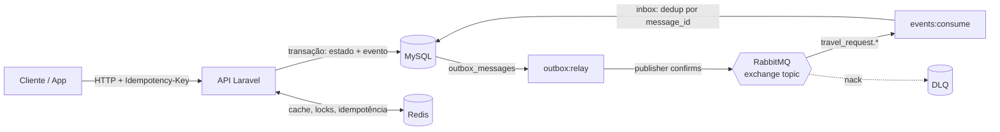

# TripFlow

**Português** · [English](README.en.md)

**API de viagens corporativas com aprovação por orçamento e eventos de domínio.** O TripFlow cobre da solicitação à emissão de reservas, com regras de acesso por empresa, controle de concorrência e integração assíncrona. A emissão usa um fornecedor simulado.

[O problema](#o-problema) · [Tecnologias](#tecnologias) · [Decisões técnicas](#decisões-técnicas) · [Arquitetura](#arquitetura) · [Rodar a demo](#como-rodar) · [ADRs](#decisões-de-arquitetura)

## O problema

Uma solicitação de viagem reserva parte de um orçamento compartilhado e pode gerar reservas em sistemas externos. Se duas aprovações leem o mesmo saldo antes de registrar o gasto, ambas podem parecer válidas e, juntas, ultrapassar o limite. Se uma chamada de reserva demora, o cliente pode repetir o pedido sem saber se a tentativa anterior já teve efeito. E se o banco grava a aprovação enquanto o broker está fora do ar, outras partes da operação podem ficar sem saber o que aconteceu.

O TripFlow usa esse fluxo para demonstrar **como manter decisões e efeitos consistentes em uma API multiempresa**. O orçamento é conferido sob lock, a API pode devolver a resposta de uma tentativa anterior e a mudança de status deixa um evento na mesma transação. A demo mostra o caminho bem-sucedido e verifica explicitamente excesso de orçamento, repetição de solicitação e acesso entre empresas.

## Tecnologias

| Tecnologia | Papel no TripFlow |
| --- | --- |
| **PHP 8.3, Laravel 12 e Sanctum** | API REST, validação, autorização por papel e tokens de acesso. |
| **MySQL 8.4** | Estado das viagens, reservas, orçamento, locks transacionais, outbox e inbox. |
| **Redis 7** | Cache de orçamento, locks distribuídos e armazenamento de respostas idempotentes. |
| **RabbitMQ 4 e php-amqplib** | Publicação de eventos de domínio, confirmações do broker e fila de mensagens rejeitadas. |
| **Docker Compose e Codespaces** | Ambiente de desenvolvimento reproduzível com API, banco, cache e broker. |
| **Pest, Larastan, Pint e GitHub Actions** | Testes, análise estática, estilo e automação de CI/CD. |

## Decisões técnicas

O domínio de viagens concentra os casos de concorrência, isolamento entre empresas e falhas entre o banco e o broker.

| Problema | Decisão e motivo | Onde |
|---|---|---|
| Evento publicado sem o banco ter commitado (ou o contrário) | A outbox registra o evento na transação da mudança de estado. O relay publica depois e reprocessa falhas com backoff. | [ADR 0002](docs/adr/0002-transactional-outbox.md) |
| Duas aprovações simultâneas estourando o orçamento | `SELECT … FOR UPDATE` serializa aprovações no mesmo centro de custo. Uma ordem fixa de locks reduz o risco de deadlock. | [ADR 0003](docs/adr/0003-concorrencia-orcamento-e-reservas.md) |
| App reenvia a requisição por timeout e duplica a reserva | `Idempotency-Key` permite repetir a resposta. O lock distribuído coordena a emissão sem manter uma transação aberta durante a chamada ao fornecedor. | `EnsureIdempotency`, `BookTravelRequest` |
| Broker reentrega a mesma mensagem | A *inbox* deduplica pelo ID da mensagem, necessário porque o relay oferece entrega pelo menos uma vez. | `NotifyTravelerOnDecision` |
| Empresa A enxergando dados da empresa B | O escopo global por `company_id` reduz a dependência de filtros manuais. O 404 evita revelar recursos de outra empresa. | [ADR 0004](docs/adr/0004-isolamento-multi-tenant.md) |
| Status "pulando" etapas | A máquina de estados concentra transições válidas em `transitionTo()`. | `TravelRequestStatus` |
| Seguir uma operação da API até o consumidor | O mesmo identificador liga a requisição HTTP, os logs e o evento assíncrono. | `AssignCorrelationId` |

## Arquitetura



```
app/
├── Domain/                 regras de negócio (não conhece HTTP)
│   ├── Travel/Actions/     um caso de uso por classe: Submit, Approve, Book…
│   ├── Travel/Enums/       máquina de estados da solicitação
│   └── Budget/             orçamento mensal por centro de custo
├── Infrastructure/         outbox, RabbitMQ, locks, correlation id
└── Http/                   controllers finos, validação, middleware de idempotência
```

### Fluxo da solicitação

```
draft ──submit──▶ pending_approval ──approve──▶ approved ──book──▶ booked
                       └──reject──▶ rejected
cancel: a partir de draft, pending_approval, approved e booked
```

Cada transição registra um evento na outbox (`travel_request.submitted`, `.approved`, `.rejected`, `.booked`, `.cancelled`).

## Como rodar

### No navegador, sem instalar nada (GitHub Codespaces)

[](https://codespaces.new/acamilateixeira/tripflow?quickstart=1)

O Codespaces sobe PHP 8.3, MySQL, Redis e RabbitMQ, instala as dependências,
roda as migrations com o seed e inicia a API, o relay da outbox e o consumidor.
Quando o terminal mostrar "Ambiente pronto", rode:

```bash
bash scripts/demo.sh
```

O script percorre o fluxo inteiro contra a API real (login, idempotência,
aprovação, orçamento, reservas, isolamento entre empresas e publicação dos
eventos) e mostra ✔ ou ✘ em cada verificação. O mesmo script roda no CI.

### Com Docker (ambiente completo)

```bash
git clone https://github.com/acamilateixeira/Tripflow.git
cd Tripflow
cp .env.example .env
docker compose up -d --build
docker compose exec api php artisan key:generate
docker compose exec api php artisan migrate --seed
```

Sobe API (`:8000`), worker de filas, relay da outbox, consumidor, MySQL, Redis e
RabbitMQ (painel em `http://localhost:15672`, guest/guest).

Confirme que a API está disponível com `curl http://localhost:8000/api/health`. Com PHP no terminal, execute `bash scripts/demo.sh`. Você também pode usar a coleção Insomnia abaixo para percorrer os endpoints manualmente.

### Local, sem Docker

No diretório do projeto, com PHP e Composer instalados:

```bash
composer install
cp .env.example .env && php artisan key:generate
touch database/database.sqlite
DB_CONNECTION=sqlite DB_DATABASE="$PWD/database/database.sqlite" CACHE_STORE=database QUEUE_CONNECTION=sync MESSAGING_DRIVER=log php artisan migrate --seed
DB_CONNECTION=sqlite DB_DATABASE="$PWD/database/database.sqlite" CACHE_STORE=database QUEUE_CONNECTION=sync MESSAGING_DRIVER=log php artisan serve --no-reload
```

Em outro terminal, use as mesmas variáveis ao rodar o roteiro, para que o relay local encontre o mesmo banco.

```bash
DB_CONNECTION=sqlite DB_DATABASE="$PWD/database/database.sqlite" CACHE_STORE=database QUEUE_CONNECTION=sync MESSAGING_DRIVER=log bash scripts/demo.sh
```

**Usuários do seed** (senha `password`): `viajante@acme.test`, `gestora@acme.test`,
`admin@acme.test` e `viajante@globex.test` (outra empresa, para testar o isolamento).

### Testando a API

A coleção do **Insomnia** está em [`insomnia/tripflow.json`](insomnia/tripflow.json):
Application → Import → selecione o arquivo. Ela traz o ambiente local, os logins e
todos os endpoints, com exemplos de idempotência e dos erros de negócio.

Entre como viajante e como gestora e copie os tokens nas variáveis da coleção. Ao criar a solicitação, use datas futuras, copie o ID retornado em `travel_request_id` e use o mesmo mês na consulta de orçamento. Para repetir o roteiro completo com datas geradas na hora, use `bash scripts/demo.sh` com a API e o ambiente local ativos. O modo SQLite usa cache no banco para preservar a idempotência entre requisições e grava os eventos no log. Use Docker Compose ou Codespaces para testar a publicação em RabbitMQ.

| Método | Rota | Descrição |
|---|---|---|
| POST | `/api/v1/auth/token` | Login, retorna token Bearer (8 h) |
| GET | `/api/v1/travel-requests` | Lista com filtro `status` e paginação por cursor |
| POST | `/api/v1/travel-requests` | Cria rascunho (aceita `Idempotency-Key`) |
| GET | `/api/v1/travel-requests/{id}` | Detalhe com reservas |
| POST | `/api/v1/travel-requests/{id}/submit` | Envia para aprovação |
| POST | `/api/v1/travel-requests/{id}/approve` | Aprova, validando o orçamento do mês |
| POST | `/api/v1/travel-requests/{id}/reject` | Recusa com motivo |
| POST | `/api/v1/travel-requests/{id}/bookings` | Emite voo/hotel/carro (aceita `Idempotency-Key`) |
| POST | `/api/v1/travel-requests/{id}/cancel` | Cancela e libera o orçamento |
| GET | `/api/v1/cost-centers/{id}/budget?month=AAAA-MM` | Orçamento, comprometido e disponível |
| GET | `/api/health` | Banco, cache e backlog da outbox |

Erros de negócio retornam `422` com um código estável:

```json
{ "error": { "code": "budget_exceeded", "message": "Orçamento insuficiente no centro de custo CC-100: …" } }
```

## Qualidade

```bash
vendor/bin/pest                 # testes de unidade, arquitetura, feature e integração
vendor/bin/phpstan analyse      # Larastan nível 8, sem baseline
vendor/bin/pint --test          # estilo
```

- **Testes de arquitetura** (Pest Arch) garantem que o domínio não depende de HTTP,
  que controllers não acessam o banco e que não sobra `dd()` no código.
- **Teste de integração** com RabbitMQ real verifica routing key, `message_id` e
  `correlation_id`. Roda no CI e é pulado localmente quando não há broker.

## CI/CD

| Workflow | Quando | O que faz |
|---|---|---|
| [`ci.yml`](.github/workflows/ci.yml) | push e PR | Pint, Larastan, `composer audit`, testes com MySQL + Redis + RabbitMQ, cobertura mínima de 80% e build da imagem |
| [`pr-validation.yml`](.github/workflows/pr-validation.yml) | PR | Título em Conventional Commits, descrição preenchida, alerta de PR grande, migrations reversíveis |
| [`ai-review.yml`](.github/workflows/ai-review.yml) | PR | Revisão do Claude com comentários inline, guiada pelo [`CLAUDE.md`](CLAUDE.md) e pelos ADRs |
| [`release.yml`](.github/workflows/release.yml) | tag `v*` | Publica a imagem no GHCR e cria o release com notas dos PRs |

**Para ativar a revisão por IA:** Settings → Secrets and variables → Actions →
*New repository secret* → `ANTHROPIC_API_KEY`.

**Para bloquear merge sem CI verde:** Settings → Branches → regra para `main` →
*Require status checks to pass* → marque `Qualidade`, `Testes` e `Título, descrição e tamanho`.

## Decisões de arquitetura

- [0001 — Registrar decisões](docs/adr/0001-registro-de-decisoes.md)
- [0002 — Transactional outbox](docs/adr/0002-transactional-outbox.md)
- [0003 — Concorrência no orçamento e nas reservas](docs/adr/0003-concorrencia-orcamento-e-reservas.md)
- [0004 — Isolamento multi-tenant](docs/adr/0004-isolamento-multi-tenant.md)

## Próximos passos

- Adapter HTTP real de fornecedor, com circuit breaker e timeout abaixo do TTL do lock.
- Front-end em Vue 3 para o painel da gestora.
- Métricas (Prometheus) para backlog da outbox e latência de publicação.

---

Feito por [Camila Teixeira](https://www.linkedin.com/in/acamilateixeira/).
